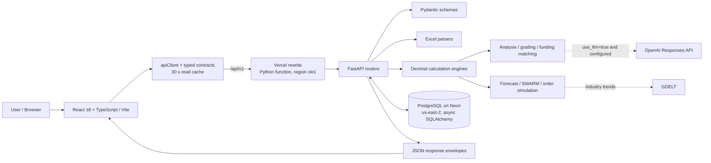

# SME Finance Copilot — Technical Documentation

**Prepared:** October 19, 2026  
**Scope:** System architecture, core algorithms, frontend design, security design, deployment, and verification, based on the repository code at commit `3d45012`.  
**Limitations:** This document describes the system as built. It is not a production security certification, a credit model validation, or a load-test report.

---

## 1. System Overview

SME Finance Copilot is a prototype that helps small and medium-sized enterprises (SMEs) understand their finances and take on larger orders together. Users import an Excel statement or submit financial data as JSON. The backend validates the data, calculates metrics, produces evidence-based findings, and previews funding, cash-flow, and order scenarios.

The system is a **decision-support tool**. It does not approve credit, submit funding applications, sign agreements, or reserve resources for shops. These operations are reported as unavailable by `GET /api/v1/capabilities`, and the UI disables them. The public demo uses synthetic records and does not enforce authentication, so real customer data must not be entered.

Three rules apply across the whole system:

1. **Unknown is never zero.** Missing inputs stay `null` and are reported in `missing`; affected metrics return `insufficient_data` or `undefined`.
2. **Numbers are calculated only by the backend.** The frontend displays values and never computes financial figures. An optional LLM may reorder existing findings but cannot calculate or add anything.
3. **Every value carries its provenance.** Responses state `kind` (`actual`, `forecast`, `simulated`), `source` (`supplied_input`, `stored_record`, `demo_dataset`, `none`), and `status`.

---

## 2. Architecture



### 2.1 Components

| Component | Location | Responsibility |
| --- | --- | --- |
| Frontend | `src/` | 13 React screens (overview, import, cash flow, health, cost, sales, funding, SWARM, per-shop plan, UNLOCK, funder portal, simulator, projects), plus AI panel, Story Mode, and command palette. |
| API client | `src/api/client.ts`, `src/api/contracts/types.ts` | The only place that calls the backend. Typed envelopes, timeouts, error mapping, read cache, and English rendering of stored Thai records. |
| Data hooks | `src/hooks/useEnvelope.ts`, `src/hooks/useCapabilities.ts`, `src/api/activeAnalysis.ts` | Load envelopes, discard stale responses, reload when the active analysis changes, and expose runtime capabilities. |
| Vercel entry | `vercel.json`, `api/index.py` | Serves the built frontend and rewrites `/api/*`, `/health`, and `/docs` to the FastAPI function. Forces `DB_BOOTSTRAP=off` in the serverless runtime. |
| FastAPI app | `backend/app/main.py`, `backend/app/routers/` | Request validation, HTTP status codes, routing to engines and repositories. Routers are mounted under both `/api` and `/api/v1`. |
| Schemas | `backend/app/schemas.py`, router models | Types, ranges, currency, dates, decimal precision, and cross-field rules, checked before any calculation. |
| Parsers | `backend/parsers/`, `backend/app/extraction.py` | Read canonical and multi-statement workbooks without evaluating formulas. |
| Engines | `finance.py`, `grading.py`, `analysis.py`, `matching.py`, `swarm.py`, `forecasting.py`, `order_simulation.py`, `simulate.py` | Pure calculation logic with no HTTP or database access. `Decimal` arithmetic; deterministic results. |
| Persistence | `repository.py`, `catalog.py`, `db.py`, `models.py`, `backend/db/*.sql` | Async SQLAlchemy over PostgreSQL. `backend/db/schema.sql` is the source of truth for 27 tables. |
| Security | `security.py`, `rbac.py`, `throttle.py`, `token_revocation.py`, `routers/auth.py` | Password hashing, signed tokens, roles, login throttling, and token revocation (see Section 7). |
| External providers | `ai_provider.py`, `industry.py` | OpenAI Responses API (optional, server-side) and GDELT industry headlines (cached, optional). |

### 2.2 Request Flow

1. The browser calls `apiClient`, which sends JSON or `multipart/form-data` to `/api/v1/...`.
2. FastAPI validates the body with Pydantic. Invalid input returns HTTP 422 without echoing raw financial values.
3. Uploads are size-checked and parsed in a worker thread (Section 3.2).
4. Engines calculate metrics with `Decimal` at precision 50 and round only for output.
5. When an SME or project identifier is supplied and the database is enabled, the router loads stored context (forecast events, expenses, resources) for that scope only.
6. The response is wrapped in an envelope: `data`, `kind`, `status`, `missing`, `asOf`, `source`, and, for writes and previews, `persisted`.
7. The frontend renders the envelope through `StateRenderer`, which maps `status` to loading, insufficient-data, error, unavailable, or stale states with a retry or next-step action.

HTTP 200 does not mean the data is complete. Callers must read `status` and each metric's `status`, `reason`, and `missingFields`.

### 2.3 Main API Groups

| Group | Example endpoints | Purpose |
| --- | --- | --- |
| Runtime | `GET /health`, `GET /api/v1/capabilities` | Service, persistence, bootstrap, and auth status; which operations are enabled. |
| Input | `POST /api/v1/inputs/manual`, `POST /api/v1/inputs/excel` | Validate input without running the full analysis. |
| Calculation | `POST /api/v1/finance/calculate`, `POST /api/v1/finance/calculate/excel` | Financial metrics only. |
| Analysis | `POST /api/v1/analyze`, `POST /api/v1/analyze/excel` | Metrics, grade, indicators, and evidence-backed findings. |
| Import | `POST /api/v1/upload/preview`, `POST /api/v1/upload` | Preview without saving, or parse, calculate, and optionally store results. |
| Read models | `GET /api/v1/overview`, `/health/indicators`, `/cost/breakdown`, `/sales/products`, `/sales/channels`, `/cashflow/timeline`, `/shops`, `/order`, `/funder/projects`, `/projects`, `/ai/explain` | Database-backed screens; each returns an empty payload with a reason in `missing` when persistence is off. |
| Previews | `POST /api/v1/cashflow/preview`, `/sales/preview`, `/forecast/preview` | Calculate from user-entered figures; never persisted (`persisted: false`). |
| Funding | `POST /api/v1/match-funding`, `POST /api/v1/funding/evaluate`, `GET /api/v1/funding/options` | Rank products and investors against supplied data or the stored catalogue. |
| SWARM | `POST /api/v1/swarm`, `GET /api/v1/swarm/proposal` | Preview an order allocation or read the latest persisted proposal. |
| Simulator | `GET /api/v1/simulator/context`, `POST /api/v1/simulate/order`, `GET /api/v1/simulations`, `POST /api/v1/simulations/{id}/replay` | Load order context, compare Plan A and Plan B, and list or replay saved runs. |
| Auth | `POST /api/v1/auth/login`, `/auth/logout`, `/auth/revoke-all`, `/auth/revoke`, `GET /api/v1/auth/me` | Token issue and revocation (enforcement off in the demo). |

The full request and response contract for every endpoint is in `docs/API_CONTRACT_MATRIX.md`.

---

## 3. Data Contracts and Import

### 3.1 FinancialInput

`FinancialInput` requires `currency` (`THB`), `kind` (`actual`, `forecast`, `simulated`), `period_start`, `period_end`, `assets`, `liabilities`, and `equity`.

- The balance sheet must satisfy `assets = liabilities + equity` within THB 0.01.
- Dates use ISO `YYYY-MM-DD`; `period_end` cannot precede `period_start`.
- Money is parsed as `Decimal` with digit and decimal-place limits; non-finite values (NaN, Infinity) are rejected. Clients should send money as decimal strings.
- Optional fields that are unknown stay `null`. Use `0` only when the source confirms the value is zero.

### 3.2 Excel Import

**Canonical workbook.** A `Financials` sheet with `field` and `value` in columns A and B; English and Thai field aliases are supported.

| Rule | Limit / behaviour |
| --- | --- |
| File type | `.xlsx` only |
| Upload size | 5 MiB (HTTP 413 above this) |
| Expanded ZIP size | 25 MiB in total |
| ZIP entries | At most 1,000 |
| Data rows | At most 100 (canonical parser) |
| Formulas and error cells | Rejected ("paste values"); workbooks are opened with `data_only=False`, `keep_links=False`, and formulas are never evaluated |
| Duplicates, unknown fields, extra columns | Rejected with a row-level message |

**Multi-statement workbook.** `backend/parsers/statement_parser.py` extracts separate financial-statement tables (up to 8 sheets, 256 rows, 6 columns each). It keeps each statement's period, currency, and scale ("million" / "ล้าน") separate, returns source-cell references and reconciliation checks, and never merges statements from different periods or currencies into one input.

**Storage.** Workbook bytes are never stored. When an upload is persisted, only parsed values, calculated results, and metadata (file name, size, SHA-256 hash) are written.

---

## 4. Core Algorithms

All money calculations use Python `Decimal` at precision 50. Money is rounded to 2 decimal places and ratios to 4 only when results are formatted.

### 4.1 Financial Metrics (`finance.py`)

| Metric | Formula |
| --- | --- |
| Net profit | `revenue - total_expenses`, or revenue less COGS, operating expenses, interest, and tax when all are supplied |
| Free cash flow | `operating_cash_flow - capital_expenditure` |
| Net cash flow | `operating_cash_flow + investing_cash_flow + financing_cash_flow` |
| ROA | `net_income / average_assets × 100` |
| ROE | `net_income / average_equity × 100` |
| Liquidity | `current_assets / current_liabilities` |
| Funding gap | `max(0, working_capital_needed − usable_cash − buyer_deposit − committed_funding)`, where `usable_cash = max(0, cash_balance − minimum_cash_reserve)` |
| DSCR | `cash_available_for_debt_service / (debt_principal_due + debt_interest_due)` |
| Loan payment (PMT) | Annuity payment from principal, annual rate, payments per year, number of periods, and timing (`end` or `beginning`) |

- ROA and ROE use the average of opening and closing balances and are not annualized.
- DSCR requires cash available for debt service explicitly; it is never substituted with operating or free cash flow.
- A zero denominator returns `undefined`, never a numeric zero.

### 4.2 A–D Financial Grade (`grading.py`, policy `demo-v1`)

Each component is scored 0–100 and weighted:

| Component | Score formula | Weight |
| --- | --- | --- |
| Debt service (DSCR) | `clamp(100 × DSCR / 1.5, 0, 100)`; zero debt service with non-negative CFADS scores 100 | 0.35 |
| Cash flow | `clamp(100 × (operating_cash_flow / revenue) / 0.20, 0, 100)` | 0.30 |
| Debt burden | `clamp(100 × (1 − liabilities / assets), 0, 100)` | 0.20 |
| Cash reserve | `clamp(100 × reserve_months / 3, 0, 100)`, where `reserve_months = cash_balance / (operating_cash_outflow × 30 / period_days)` | 0.15 |

```text
G = 0.35·dscr + 0.30·cash_flow + 0.20·debt_burden + 0.15·cash_reserve   (round half up, 2 dp)
A ≥ 80    B ≥ 65    C ≥ 50    D < 50
```

If any component is missing or undefined, **no overall score or grade is produced**. The response still lists every component's status, missing fields, reason, and the policy version. This is a demo scoring policy, not a credit decision or probability of default.

### 4.3 Rules-Based Analysis and Optional LLM (`analysis.py`, `ai_provider.py`)

`build_analysis` combines metrics, the grade, indicators, and findings. Every finding must reference an available metric or evidence item and carries confidence and limitations. Forecast and expense context is added only when supplied and when its date coverage requirements are met.

The default mode is deterministic and makes no external call. When a request sets `use_llm` and the server has `OPENAI_API_KEY` and `OPENAI_MODEL`:

- The server sends metrics, the grade, and findings to the OpenAI Responses API with `store: false`, `max_output_tokens: 600`, and a 15-second timeout.
- The output is constrained by a strict JSON schema whose only field is a list of **existing finding IDs** (an enum of the supplied IDs).
- The instructions forbid calculating numbers, assigning grades, adding findings, or implying approval, and tell the model to treat supplied data as data, not instructions.
- On a missing configuration, provider error, or malformed output, the system falls back to the rules ordering and returns a warning. The API key is never returned or logged in responses.

### 4.4 Funding Matching (`matching.py`, policy `funding-match-demo-v1`)

For each active product in the catalogue:

1. **Hard rejections:** inactive product, requested amount outside the product range, a grant carrying an interest rate, or post-funding DSCR below the product floor (at least 1.0 for repayable products).
2. **Post-funding DSCR** adds the new product's installments that fall inside the statement period (monthly PMT × min(period months, term months), with partial months counted by calendar days) to the existing debt service.
3. **Score (0–100):** coverage 45%, grade 25%, financing cost 20%, disbursement speed 10%.
   - Coverage: `min(1, DSCR / max(floor, 1.5)) × 45` (grants receive full coverage points).
   - Grade: `score × 0.25`.
   - Cost: `max(0, 1 − total_interest / amount) × 20`.
   - Speed: `max(0, 1 − disbursement_days / 30) × 10`.
4. **Status:** `not_eligible` (score 0) when rejected, `requires_info` when inputs are missing, otherwise `eligible`.

Investors are screened the same way against ticket size, sector, minimum grade, minimum DSCR, risk appetite, and horizon. Every result includes the notice that it is a ranking of supplied criteria, not credit approval or an investment offer.

### 4.5 SME SWARM Allocation (`swarm.py`)

The engine splits one buyer order across several shops. It is pure and deterministic (no I/O, no randomness), so the same request always gives the same proposal.

1. **Eligibility.** A shop is excluded if its business type does not match the order, if it lies beyond `max_distance_km` (haversine distance in km; coordinates required when a limit is set), or if a **required** resource is not both available and confirmed. Unavailable optional resources are reported as preferences only.
2. **Ranking.** Eligible shops are ordered by cost per unit, then distance, then free capacity (larger first), then shop ID as a stable tie-break.
3. **Allocation.** Each shop takes `min(free capacity, remaining target)` until the target is met.
4. **Cash exposure per shop.** A finite order schedule is built: production costs fall before buyer collections on the same day, and there is no production during credit days.
   - `working_capital` = peak cumulative production-cost deficit after collections, excluding the deposit.
   - `funding_gap = max(0, peak deficit including deposit − max(0, cash_balance − minimum_cash_reserve))`.
5. **Shop status.** `ready` (no gap), `review` (gap ≤ 30% of the shop's working capital), or `blocked`.
6. **Proposal status.** `incomplete` if capacity is still short (the unassigned units and the exclusion reasons are listed), `has_issues` if any shop has a gap or issue, otherwise `ready`.

### 4.6 Cash-Flow Forecast (`forecasting.py`)

- Opening cash includes all movements up to `as_of`; the forecast covers the next 90 days with end-of-day netting.
- The schedule must be explicitly confirmed complete (`schedule_complete_through`). The last event date is never assumed to be the end of the schedule.
- Missing opening cash, events, or completeness are returned in `missing`; no balance is projected from incomplete data.
- Simulated events are excluded unless explicitly requested.
- The lowest balance and its date are reported against the minimum cash reserve.

The **Cash & Cash Flow preview** lets a user enter opening cash, a reserve, and dated events (within 1–90 days of the start date) to see this calculation without stored data. The **Sales & Products preview** does the same for product and channel figures. Both are labelled *simulated — not saved* and return `persisted: false`.

### 4.7 Order Simulation (`order_simulation.py`, `simulate.py`)

The simulator compares **Plan A** (stored order context) with **Plan B** (user-changed price, cost, deposit, credit days, or a resource outage) by running the SWARM engine on both and returning the differences in capacity, profit, and funding gap. Previews use `persist: false`. Saving a plan writes a simulation record and reads it back; the save is reported as confirmed only if the read-back matches.

---

## 5. Frontend Design

| Topic | Implementation |
| --- | --- |
| Data access | All calls go through `apiClient`; screens never call `fetch` directly and never compute financial values. |
| Envelope handling | `useEnvelope` keeps only the newest response, reloads when the active analysis or language changes, and turns failures into an error state with retry. |
| Capabilities | `useCapabilities` reads `GET /capabilities` once; actions such as funding application, agreement signing, or report export are disabled with the backend's reason. |
| Labels | `DataKindBadge` shows Actual / Forecast / Simulated on key figures; `null` renders as "No data", never `0`. |
| Read cache | Successful GET responses are cached in memory for 30 seconds and shared by concurrent callers. Any POST that may write data, and any sign-in change, clears the cache. Calculation-only POSTs (`/swarm`, previews) are cached by request body instead of clearing it. |
| Page loading | Pages are lazy-loaded and the remaining page bundles are prefetched while the browser is idle (skipped when Save-Data is on). |
| Languages | Thai and English UI text in `src/i18n` (1,212 keys; `th.ts` is type-checked against `en.ts`, so a missing key fails the build). In English mode, known Thai database records (order titles, locations, resources, cash events, products, funding types, chaos scenarios) are rendered in English by `src/api/dataTranslations.ts`; numbers inside those texts are taken from the record itself, and unknown text is shown unchanged. |
| Responsive layout | Desktop sidebar; tablet and phone use a bottom tab bar plus a "More" drawer with all 13 pages. Verified at 390 px width with no content past the right edge. |
| Motion and accessibility | Entrance animations, 3D tilt cards, and the hero backdrop are CSS-only and switch off with the in-app reduced-motion toggle or the OS `prefers-reduced-motion` setting. Tilt is mouse-only. Controls have keyboard access and ARIA labels. |

---

## 6. Deployment and Configuration

**Topology.** One Vercel project serves the static frontend and a Python serverless function for the API. The function runs in region `cle1` (Cleveland) to sit next to the Neon PostgreSQL database in AWS `us-east-2` (Ohio). Before this change the function ran in Singapore and each database read took 2.5–6.5 seconds; end-to-end requests from Thailand now take about 0.8–1 second, most of which is network distance.

**Connections.** The database engine uses `NullPool` by default because an asyncpg connection belongs to one event loop and serverless invocations do not share loops. `DB_POOL=queue` enables pooling for a long-lived server. The connection URL's `sslmode` is translated to asyncpg's `ssl` option; libpq-only parameters such as `channel_binding` are removed.

**Caching.** Hashed assets under `/assets/` are served with `Cache-Control: public, max-age=31536000, immutable`; `index.html` is revalidated on every visit.

**Environment variables (server-side only):**

| Variable | Purpose |
| --- | --- |
| `DATABASE_URL` | PostgreSQL connection string. Empty means stateless mode. |
| `DB_BOOTSTRAP` | Apply schema and seed on start-up; forced `off` on Vercel. |
| `DB_POOL` | `null` (default) or `queue`. |
| `CORS_ORIGINS` | Comma-separated allowed origins (same-origin on Vercel needs none). |
| `AUTH_SECRET` | Token signing secret, at least 32 characters. No default. |
| `AUTH_TOKEN_TTL_SECONDS` | Token lifetime (default 12 hours). |
| `RBAC_ENFORCED` | `true` to require tokens and roles. Default `false`. |
| `AUTH_DEV_HEADER` | Local-only identity header; reported in `/health`. |
| `OPENAI_API_KEY`, `OPENAI_MODEL` | Optional LLM prioritization. |

**Frontend build variables:** `VITE_USE_MOCK=false` and `VITE_API_BASE_URL=/api/v1`, set in `vercel.json`. No secret may use a `VITE_` prefix, because these values are embedded in the public JavaScript bundle.

---

## 7. Security Design

### 7.1 Secrets and Data Handling

- Database credentials, the signing secret, and provider keys exist only in server environment variables; none are in the repository or the frontend bundle.
- Workbook bytes are never stored; only parsed values and metadata are persisted.
- Validation errors are returned without input values or exception context (`include_input=False`, `include_context=False`).
- The OpenAI request sets `store: false`.

### 7.2 Input and Upload Hardening

- Strict Pydantic models (`extra="forbid"` on core requests), bounded string lengths, numeric ranges, and finite-decimal checks.
- Upload limits on file size, expanded ZIP size, and ZIP entry count protect against ZIP bombs; formulas and external links are never evaluated.
- Database queries use SQLAlchemy expressions or `text()` with bound parameters; no SQL is built by concatenating user input.

### 7.3 Authentication

- **Passwords:** scrypt (`N = 2^14`, `r = 8`, `p = 1`, 16-byte random salt), compared in constant time. An account without a password can never authenticate.
- **Tokens:** `base64url(payload).base64url(HMAC-SHA256)`, version `v2`, with a random 16-byte `jti`. There is no algorithm field read from input, so JWT algorithm-confusion attacks do not apply. The signature is verified before the payload is parsed.
- **No default secret:** without `AUTH_SECRET` no token can be issued or accepted.
- **Revocation:** single-token logout, revoke-all for one's own account, and admin revoke for another account, backed by the `revoked_tokens` table and a per-account cutoff time. A revoked token gets the same 401 as a forged or expired one.
- **Login throttling:** 8 failures within 15 minutes lock the identifier for 15 minutes. Identifiers are stored hashed with the secret as a pepper; a successful login clears the counter.

### 7.4 Authorization

Roles: `sme_owner`, `investor`, `analyst`, `admin`. An `sme_owner` may act only for its own SME; funder-only detail is shown only to `investor`, `analyst`, or `admin`. Enforcement is controlled by `RBAC_ENFORCED`, and `/health` reports `enforced`, `secretConfigured`, and `devHeaderAccepted` so that an insecure configuration is visible.

### 7.5 Current Demo Posture and Known Gaps

| Item | Status at the time of writing |
| --- | --- |
| Authentication enforcement | **Off** (`/health`: `enforced=false`, `secretConfigured=false`). The demo has no login, no tenant isolation, and no per-user data boundary. |
| Customer data | Must not be entered. All stored records are synthetic. |
| Rate limiting | Login throttling only; other endpoints have no per-client limit. |
| Load testing | Not performed. The prototype is suitable for supervised, low-volume use. |
| Business commitments | Funding applications, agreement signing, funder information requests, report export, and resource reservation are disabled (`/capabilities`). |

Before handling real data, the minimum steps are: set `AUTH_SECRET`, enable `RBAC_ENFORCED`, add login to the frontend, restrict `CORS_ORIGINS`, add rate limiting to public endpoints, run a load test, and review data retention for the `upload_events`, `financial_records`, and `ai_analyses` tables.

---

## 8. Verification

| Check | Command | Result (October 19, 2026) |
| --- | --- | --- |
| Frontend build and type check | `pnpm build` | Passes |
| Frontend invariants | `pnpm test:invariants` | 10 of 10 pass |
| Backend unit and contract tests | `python -m pytest -c backend/pytest.ini -q` | 441 passed, 122 skipped (the skipped tests need a dedicated PostgreSQL database; run `backend/scripts/test_with_postgres.py` for the full suite) |
| Main flow against the API | Import → analyze → AI explanation, plus cash and sales previews | Passes |
| Browser checks | All 13 pages in Thai and English at desktop, tablet, and 390 px phone widths | No JavaScript errors, no horizontal overflow, no Thai text left in English mode |
| Live deployment | `GET /health`, `GET /api/v1/capabilities` | `persistence=true`, `bootstrap=off`, `auth.enforced=false` |

---

## 9. Limitations

- Grades, funding rankings, and SWARM proposals follow demo policies on synthetic data; they are not lender decisions.
- Forecasts require a confirmed-complete schedule of dated events; statement totals alone cannot produce a dated cash timeline or a product/channel breakdown.
- English rendering of stored Thai records covers the records present at the time of writing. New free-text records stay in the language they were entered in until a translation is added or the database stores both languages.
- Industry trends depend on an external provider and may be unavailable.
- The API function runs in the US next to the database, so users in Thailand see about 0.6–1 second per database-backed request; moving both to Singapore would reduce this.
